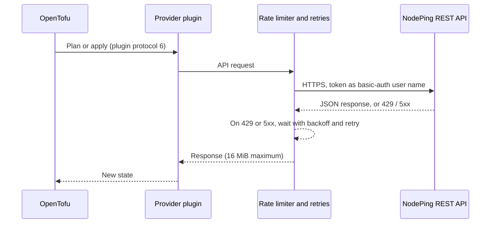

<!--
doc: readme
standard: ASD-STE100 (about 80%)
last-refreshed: 2026-10-14
generated-by: doc-refresh skill
-->

# OpenTofu Provider for NodePing

This provider manages [NodePing](https://nodeping.com) monitoring as code. It manages
checks, contacts, and the subaccounts that hold them.

Atlantic BT develops this provider, and Doug Eubanks
([@RealDougEubanks](https://github.com/RealDougEubanks)) maintains it. It started as a fork of
[phizzl/terraform-provider-nodeping](https://github.com/phizzl/terraform-provider-nodeping)
by Phillip Schleicher (MPL-2.0). See [Attribution](#attribution) and [NOTICE.md](NOTICE.md).

> **CAUTION:** This provider targets OpenTofu, not Terraform. Write-only attributes and
> provider `for_each` operate differently in Terraform, or do not exist. See
> [OpenTofu compatibility](#opentofu-compatibility).

> **SECURITY:** The provider uses a NodePing API token. The state file can contain check
> credentials and webhook headers that carry tokens. Encrypt your state. Read
> [SECURITY.md](SECURITY.md) before you use this provider in production.

## Quick Start

> **Prerequisites:** OpenTofu 1.12 or later, and a NodePing account with an API token.

1. Add the provider to your configuration:

   ```hcl
   terraform {
     required_providers {
       nodeping = {
         source  = "atlanticbt/nodeping"
         version = "~> 1.1"
       }
     }
   }

   provider "nodeping" {}
   ```

   > **SECURITY:** Do not write the token into a file. Keep it out of shell history.

2. Set the API token in the environment:

   ```bash
   read -rs NODEPING_API_TOKEN && export NODEPING_API_TOKEN
   ```

3. Add a check:

   ```hcl
   resource "nodeping_check" "www" {
     label    = "www.example.com"
     type     = "HTTP"
     target   = "https://www.example.com"
     interval = 5
   }
   ```

4. Download the provider and examine the plan:

   ```bash
   tofu init
   tofu plan
   ```

5. Create the check:

   ```bash
   tofu apply
   ```

## Architecture in 30 Seconds



The client sends at most 10 requests each second by default (`internal/client/client.go:28`).
It retries a failed request 3 times by default, with a backoff from 1 to 30 seconds
(`internal/client/client.go:29`). It does not send a POST again after NodePing receives it.

## Status

| Item | Value |
|---|---|
| Provider address | `atlanticbt/nodeping` |
| Minimum OpenTofu version | 1.12 |
| Registry | [OpenTofu Registry](https://search.opentofu.org/provider/atlanticbt/nodeping). Terraform Registry publication is optional; see [docs/releasing.md](docs/releasing.md). |
| API coverage | All 7 NodePing CRUD (create, read, update, delete) resources |

**Resources:** `nodeping_check`, `nodeping_contact`, `nodeping_contactgroup`,
`nodeping_schedule`, `nodeping_notificationprofile`, `nodeping_maintenance`,
`nodeping_subaccount`.

**Data sources:** a singular and a plural data source for each resource, plus
`nodeping_account` and `nodeping_accounts`.

Acceptance tests run each resource against the live NodePing API. The provider imported and
managed a large production NodePing estate without drift. Sometimes the NodePing API does not
agree with its own documentation. [docs/assumptions.md](docs/assumptions.md) records the
behavior that we saw and how the provider handles it.

## Documentation

| Page | Contents |
|---|---|
| [docs/index.md](docs/index.md) | Provider arguments, authentication, default tags |
| [docs/resources/](docs/resources/) | One reference page for each resource |
| [docs/data-sources/](docs/data-sources/) | One reference page for each data source |
| [docs/notification_dependency.md](docs/notification_dependency.md) | How to suppress alerts when an upstream check is down |
| [docs/ENV_VARS.md](docs/ENV_VARS.md) | All environment variables, for users and for tests |
| [docs/RUNBOOK.md](docs/RUNBOOK.md) | Health checks, known failure modes, rollback, escalation |
| [CONTRIBUTING.md](CONTRIBUTING.md) | Local builds, tests, and project rules |
| [SECURITY.md](SECURITY.md) | How to report a vulnerability, and the security controls |
| [CHANGELOG.md](CHANGELOG.md) | Changes in each release |
| [docs/assumptions.md](docs/assumptions.md) | Design decisions, and the NodePing API behavior that we observed |

## Installation

Add the provider to `required_providers`:

```hcl
terraform {
  required_version = ">= 1.12.0"
  required_providers {
    nodeping = {
      source  = "atlanticbt/nodeping"
      version = "~> 1.1"
    }
  }
}
```

Run `tofu init`. OpenTofu downloads the provider from the OpenTofu Registry. CI builds each
release and signs its checksums.

## Configuration

> **SECURITY:** Do not write the API token into a `.tf` file. Set the `NODEPING_API_TOKEN`
> environment variable, or pass the value from a secret store through a sensitive variable.

```hcl
provider "nodeping" {
  api_token = var.nodeping_api_token

  # The provider adds these tags to each check that this provider instance manages.
  default_tags = ["managed-by-tofu"]
}
```

| Argument | Environment variable | Required | Description |
|---|---|---|---|
| `api_token` | `NODEPING_API_TOKEN` | Yes | The NodePing API token. The provider reads no other variable for the token. |
| `customer_id` | `NODEPING_CUSTOMER_ID` | No | The default subaccount for resources that do not set `customer_id`. |
| `api_url` | `NODEPING_API_URL` | No | The API base URL. For tests only. It must use `https`, except on a loopback host. |
| `default_tags` | — | No | Tags that the provider adds to each managed check. Empty strings are not permitted. |
| `rate_limit` | — | No | The maximum requests per second. Must be more than 0. Default `10`. |
| `max_retries` | — | No | The number of retries after a failed request. Default `3`. Set `0` for one attempt only. |
| `retry_wait_min`, `retry_wait_max` | — | No | The minimum and maximum seconds between retries, with exponential backoff. Defaults `1` and `30`. Set `0` to retry with no wait. `retry_wait_min` must not be more than `retry_wait_max`. |

A value in the provider block overrides the environment variable. A parent-account token can
reach each of its subaccounts through `customer_id`. A token that you create for a subaccount
can reach only that subaccount.

## Usage

```hcl
resource "nodeping_contact" "ops" {
  name = "Ops Team"

  address {
    type    = "email"
    address = "ops@example.com"
  }
}

resource "nodeping_check" "www" {
  label    = "example.com"
  type     = "HTTP"
  target   = "https://www.example.com"
  interval = 5
  enabled  = true
  tags     = ["tier-critical"]

  notifications {
    contact_id = nodeping_contact.ops.address[0].id
    delay      = 0
    schedule   = "All"
  }
}
```

A check sends notifications to a contact **address**, not to a contact. Use the address ID
(`nodeping_contact.ops.address[0].id`) in `notifications.contact_id`. The
[nodeping_contact](docs/resources/nodeping_contact.md) page explains the difference.

### Subaccounts

A parent-account token can manage each of its subaccounts. Set `customer_id` on the
resource to select the subaccount. A token for one subaccount needs no `customer_id`.

> **CAUTION:** A change to `customer_id` replaces the resource. NodePing cannot move a
> check from one account to a different account.

```hcl
resource "nodeping_check" "client_site" {
  customer_id = "201203232048C76FH"
  label       = "client site prod"
  type        = "HTTP"
  target      = "https://www.example.net"
}
```

For many subaccounts, use the OpenTofu provider `for_each`. Do not write one alias for each
subaccount.

```hcl
provider "nodeping" {
  alias    = "sub"
  for_each = var.subaccounts

  api_token   = var.nodeping_api_token
  customer_id = each.value
}

resource "nodeping_check" "site" {
  for_each = var.monitored_sites # must NOT be the same expression as the provider's

  provider = nodeping.sub[each.value.subaccount]
  label    = each.key
  type     = "HTTP"
  target   = each.value.url
}
```

The `for_each` expression of the resource must be different from the expression of the
provider. OpenTofu requires this. A provider instance must exist longer than its resources,
so that a destroy operation can still reach them.

### Credentials on checks

Some check types use a login: `FTP`, `IMAP4`, `MYSQL`, `POP3`, `SMTP`, and `SSH`. These
types accept a password.

> **SECURITY:** Use `password_wo` for the password. It is write-only. NodePing receives the
> value, but OpenTofu does not write it to state or to a saved plan file.

> **SECURITY:** Read the secret with an `ephemeral` block, not a `data` block. A `data`
> source stores its result in state, so the plaintext gets into state.

```hcl
ephemeral "aws_secretsmanager_secret_version" "db" {
  secret_id = "nodeping/db-monitor"
}

resource "nodeping_check" "db" {
  label    = "prod mysql"
  type     = "MYSQL"
  target   = "db.example.com"
  username = "monitoring"

  password_wo         = ephemeral.aws_secretsmanager_secret_version.db.secret_string
  password_wo_version = 1 # increase this number to rotate the password
}
```

To rotate the password, do these steps:

1. Change the secret in your secret store.
2. Increase `password_wo_version` by 1.
3. Run `tofu apply`.

OpenTofu cannot see a change to a write-only value. A change to `password_wo_version` is
the only thing that starts an update. OpenTofu also rejects an ephemeral value in an attribute
that is not write-only. Thus, a wrong assignment fails at plan time and does not leak the
secret.

> **SECURITY:** The deprecated `password` attribute writes the password to state in
> plaintext. Do not use it. `password` and `password_wo` cannot be used together.

NodePing stores check passwords in plaintext and returns them through its API. Write-only
attributes protect your state, but they cannot protect the NodePing storage. Give each
authenticated check a monitoring-only credential with minimum permissions.

### Importing

Import a resource with its ID. For a subaccount resource, put the customer ID first:

```bash
tofu import nodeping_check.www CHECK-ID
tofu import nodeping_check.client 201203232048C76FH:CHECK-ID
```

The subaccount form writes `customer_id` into state. Later plans then use the same account.

> **CAUTION:** Set the same `customer_id` in your configuration. If you do not, the next plan
> replaces the resource.

All resources also support **resource identity**. An `import` block can then identify the
resource with attributes, not with a string that contains a colon:

```hcl
import {
  to = nodeping_check.client
  identity = {
    id          = "CHECK-ID"
    customer_id = "201203232048C76FH"
  }
}
```

The identity is `id` and `customer_id` on each resource, except `nodeping_subaccount`. The
identity of `nodeping_subaccount` is `id` only. Both import methods operate.

## Key Files

| Path | Purpose |
|------|---------|
| `main.go` | The provider entry point. It sets the provider address `registry.opentofu.org/atlanticbt/nodeping`. |
| `internal/provider/provider.go` | The provider schema and configuration: token, account, URL, retries, default tags. |
| `internal/client/` | The NodePing API client: authentication, rate limiting, retries, and response limits. |
| `internal/resources/<name>/` | One package for each resource: schema, create, read, update, delete, and import. |
| `internal/resources/identity/` | Resource identity and create-recovery code that all resources share. |
| `internal/datasources/<name>/` | One package for each data source. |
| `docs/` | The registry pages, the runbook, and the design log. |
| `examples/` | Example configurations for each resource. |
| `.github/workflows/` | CI (`ci.yml`), signed releases (`release.yml`), and weekly acceptance tests (`acceptance.yml`). |
| `.golangci.yml` | The lint configuration. |

## Commands

| Command | What it does |
|---------|-------------|
| `make build` | Build the provider binary. |
| `make test` | Run the unit tests with the race detector. |
| `make cover` | Run the tests and write `coverage.out` and `coverage.html`. |
| `make lint` | Run golangci-lint v2.14.0. |
| `make fmt` | Format the Go code. |
| `make vet` | Run `go vet`. |
| `make vulncheck` | Run govulncheck. |
| `make tidy` | Run `go mod tidy`. |
| `make install` | Build and install into the local OpenTofu filesystem mirror. |
| `make test-acc` | Run the acceptance tests against the live NodePing API. |
| `make test-acc-subaccount` | Run the test that creates and deletes a real subaccount. |
| `make clean` | Remove build artifacts. |
| `make help` | Show the targets. |

[CONTRIBUTING.md](CONTRIBUTING.md) gives the procedures for local builds, acceptance tests, and
pull requests.

### Acceptance tests

> **WARNING:** Acceptance tests create and destroy live NodePing resources. Use a token for a
> test account that contains nothing of value. Do not use a production account.

> **SECURITY:** Do not type the token on the command line. It stays in shell history.

```bash
read -rs NODEPING_API_TOKEN && export NODEPING_API_TOKEN   # token for a test-only account
make test-acc
```

[docs/ENV_VARS.md](docs/ENV_VARS.md) lists the fixture variables. CONTRIBUTING.md gives the
test rules.

## Troubleshooting

| Symptom | Likely cause | Fix |
|---------|-------------|-----|
| `Missing NodePing API Token` | Neither `api_token` nor `NODEPING_API_TOKEN` is set. | Set `NODEPING_API_TOKEN`. The provider does not read `NODEPING_API_KEY`. |
| `NodePing API error (status 401, ...)` or `(status 403, ...)` | The token is wrong or revoked, or it cannot reach the account in `customer_id`. | Make a new token in NodePing. Check `customer_id`. |
| Applies are slow, with many retries | NodePing returns 429 (rate limit). | Lower `rate_limit` in the provider block. |
| A resource disappears from state, and the plan creates it again | Someone deleted the object in NodePing. | Make sure that the deletion was intended. Apply, or remove the resource from the configuration. |
| `Cannot Remove Every Contact Address` | The change removes the last address of a contact. | Keep one address, or delete the contact. |

[docs/RUNBOOK.md](docs/RUNBOOK.md) gives all known failure modes, health checks, and the
rollback procedure.

## OpenTofu compatibility

This provider uses these features. Terraform operates differently for each feature, or does
not have it.

| Feature | Notes |
|---|---|
| Write-only attributes | OpenTofu 1.11 and later. We verified that the values are not in state and not in saved plan files. |
| Provider `for_each` | OpenTofu 1.9 and later. Terraform has no equivalent. |
| Resource identity | OpenTofu 1.12 and later. |
| State encryption | OpenTofu 1.7 and later. We recommend it for consumers. The provider does not require it. |

Do not add code that reads `req.TerraformVersion`. OpenTofu 1.12 sends the string `"1.13.0"`
to each provider, and it does not identify itself as OpenTofu. A version test against this
value has no meaning. CONTRIBUTING.md gives all the provider rules.

## Security

Report a vulnerability privately. Do not open a public issue.
[SECURITY.md](SECURITY.md) gives the procedure.

## Attribution

Atlantic BT develops this provider, and Doug Eubanks
([@RealDougEubanks](https://github.com/RealDougEubanks)) maintains it.

Phillip Schleicher wrote the original provider as
[phizzl/terraform-provider-nodeping](https://github.com/phizzl/terraform-provider-nodeping).
His work includes the plugin-framework layout, the NodePing API client, and the check and
contact resources. This repository continues from that work, with the same license.

## License

Mozilla Public License 2.0. See [LICENSE](LICENSE) and [NOTICE.md](NOTICE.md).
